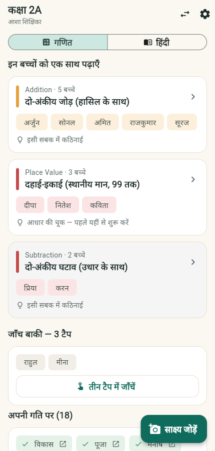
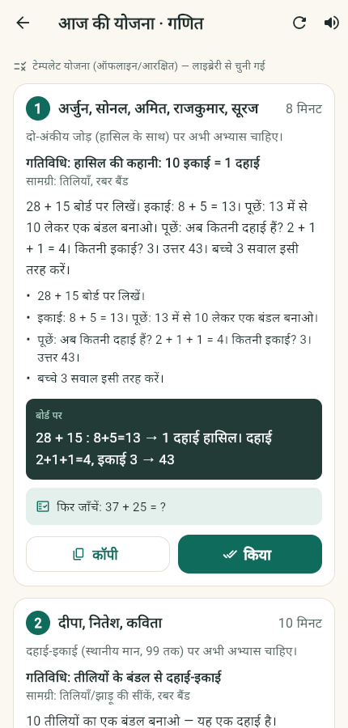
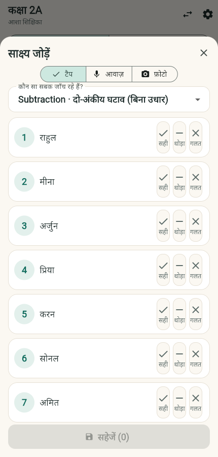
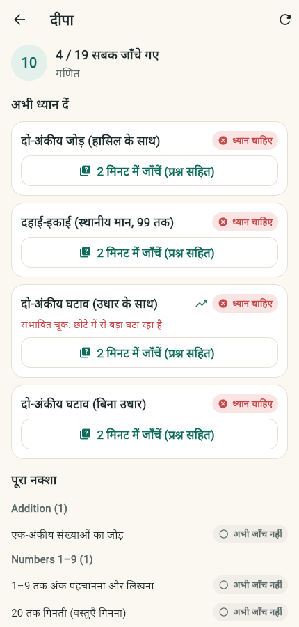
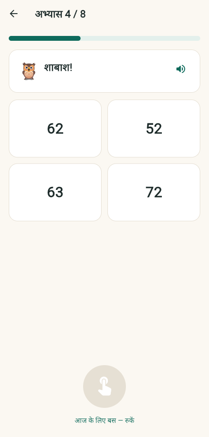
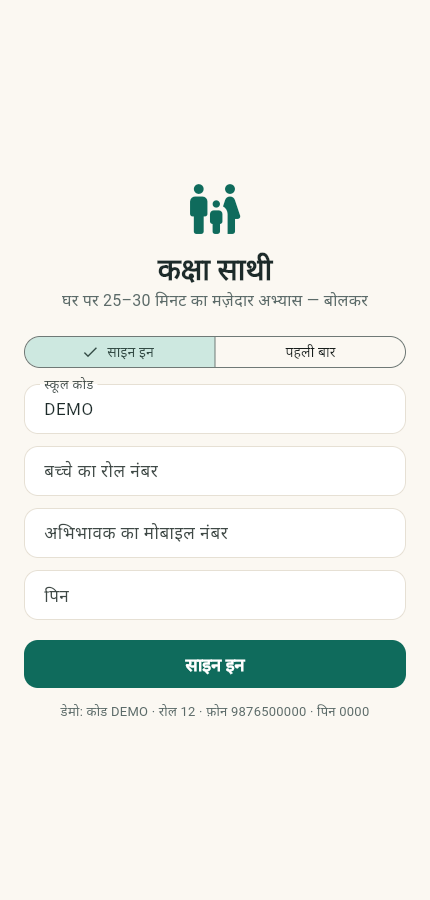

# कक्षा साथी · Kaksha Saathi

**A continuous learning-gap and intervention system for Indian primary classrooms.**
Teacher app for diagnosis → grouping → intervention → reassessment. Parent app for structured
voice practice at home. Both read and write **one child-level learning map**.

AI for Foundational Learning Hackathon · ShikshaNext × Anthropic · Build stage submission.

| Teacher: today's groups | Teacher: one group's plan | Teacher: 20-second capture |
|---|---|---|
|  |  |  |

| Child profile | Parent: daily session | Parent: gate |
|---|---|---|
|  |  |  |

---

## Quick start (local, no Docker, no API keys)

```bash
cd backend
python3 -m venv .venv && .venv/bin/pip install -r requirements.txt
.venv/bin/uvicorn app.main:app --reload          # seeds the demo school on first boot
```

Open **http://localhost:8000** — landing page with both apps and the API docs.
Everything works with **no Claude key and no speech key**: the app uses its deterministic rules,
the reviewed activity library and the template planner, and says so in the UI.

With Docker + Postgres: `docker compose up --build` (same URLs).

### Demo credentials (all children are fictional)

| Role | How to sign in |
|---|---|
| Teacher | school code `DEMO`, PIN `1234` |
| Parent | school code `DEMO`, roll `12`, phone `9876500000`, PIN `0000` |

Try, in order: open the 2A board → open the **हासिल (carrying)** group card → the plan → back →
tap **साक्ष्य जोड़ें** → write a note like
`आज उधार वाला घटाव कराया। मीना को उधार समझ नहीं आया। अर्जुन ने सही किया। प्रिया नहीं आई।`
→ check the chips → confirm → the board and the child's profile change.

---

## What is here

| Path | What |
|---|---|
| `backend/` | FastAPI service: mastery engine, grouping, plan templates, AI orchestration, speech, API |
| `content/` | Reviewed learning content: competency graph, activity library, practice items, probes |
| `apps/teacher/` | Flutter app (Android + Web) — capture, board, plan, child profile |
| `apps/parent/` | Flutter app (Web PWA + Android) — parent gate, session harness, history |
| `evals/` | Golden sets + runnable evaluation harness (extraction, planner, scorer) |
| `deploy/web/` | Built web apps + landing page, served by the API at `/` |
| `docs/` | Full design set: technical report, architecture, domain design, AI spec, eval plan, build plan, risks |

Design docs (read `docs/00_README.md` first):
[01 Technical Report](docs/01_TECHNICAL_REPORT.md) ·
[02 Architecture](docs/02_ARCHITECTURE.md) ·
[03 Domain & Design](docs/03_DOMAIN_AND_DESIGN.md) ·
[04 AI Specification](docs/04_AI_SPECIFICATION.md) ·
[05 Evaluation Plan](docs/05_EVALUATION_PLAN.md) ·
[06 Build Plan](docs/06_BUILD_PLAN.md) ·
[07 Risks & Decisions](docs/07_RISKS_AND_DECISIONS.md)

---

## How the loop works

```
roadmap (photo → draft → teacher confirms)
   → evidence: voice note | work photo | classroom voice | tap | teacher note
   → teacher confirms what the AI understood
   → MASTERY ENGINE (code): source-weighted, decayed, prerequisite-aware  → status per checkpoint
   → GROUPING (code): children with the same foundational gap
   → INTERVENTION (Claude picks only from the reviewed library, code validates; template fallback)
   → reassessment
   → home practice (structured harness; Claude writes the language, code judges the answers)
   → back into the same map
```

**Design rule:** AI reads messy inputs and writes language. Code decides status, counts, applies
arithmetic and enforces every constraint. Every AI output is a *proposal* the teacher confirms.

---

## API in one screen

```
POST /v1/auth/login                      school code + PIN → JWT
GET  /v1/classes/{id}/board?subject=      groups / on-track / unassessed
POST /v1/classes/{id}/plans?subject=      today's plan (AI, else template)
POST /v1/classes/{id}/captures/note       multipart audio or transcript → proposed chips
POST /v1/classes/{id}/captures/photo      work page → per-question verdicts (arithmetic-checked)
POST /v1/classes/{id}/captures/voice      target words + audio → per-item scores → proposal
POST /v1/classes/{id}/captures/tap        zero-AI direct evidence
POST /v1/captures/{id}/confirm            the teacher's confirmation commits evidence
GET  /v1/children/{id}/profile?subject=   the learning map
POST /v1/parent/login · /v1/parent/pack · /v1/parent/sessions/{id}/turn
DELETE /v1/children/{id}/data · /v1/classes/{id}/data
```

Interactive reference: `/docs`. Health: `/healthz`, `/readyz`. Every response carries `x-response-ms`.

---

## Offline & low-connectivity matrix

| Feature | Offline | Notes |
|---|---|---|
| Teacher login (after first success) | ✅ | token cached |
| Board, plan, profiles | ✅ | last successful copy, banner says so |
| Tap checklist | ✅ (on reconnect) | the screen works; saving needs the network |
| Voice note | ⚠️ capture only | transcription needs the network; typed note works |
| Work photo analysis | ❌ | needs Claude vision; fall back to tap |
| Classroom voice judging | ❌ | needs ASR; fall back to tap |
| Parent pack download | ✅ once | ~1–2 MB, cached in the browser/app |
| Parent session | ✅ | same harness locally, canned lines, tap fallback |
| Plan generation | ✅ | template planner runs on the server; if offline, the last plan is shown |
| Hindi read-aloud | ✅ Android (device TTS), ✅ web (browser SpeechSynthesis) | |

**Devices:** Android 8+ phone with 2 GB RAM is the target. No child device is required; the parent
app is a PWA + optional APK.

---

## External services and where keys are needed

| Service | Used for | Env var | Without it |
|---|---|---|---|
| Anthropic Claude (`claude-haiku-4-5`, `claude-sonnet-5`) | note/photo extraction, plan, tutor, safety | `ANTHROPIC_API_KEY` | deterministic rules + template planner + canned tutor lines; UI marks the degraded state |
| Sarvam AI (ASR + TTS) | Hindi speech-to-text, model pronunciation | `SARVAM_API_KEY` | typed notes / tap only; no audio verification |
| Postgres (optional) | production database | `DATABASE_URL` | SQLite file |
| Object storage (optional) | work photos (7-day TTL) | — | local `uploads/` |

Copy `backend/.env.example` → `backend/.env`. **Never commit keys.** No real personal data is in
this repository; the demo children are fictional.

---

## Evaluation

Three runnable harnesses, no API key required for the deterministic modes:

```bash
cd backend
.venv/bin/python ../evals/run_extraction.py --mode rules   # child-event F1, absence F1
.venv/bin/python ../evals/run_planner.py                   # plan validity, coverage, time budget
.venv/bin/python ../evals/run_scorer.py                    # word-level agreement + Cohen's κ
```

Current development-set results (see `evals/reports/`):

| Harness | Result |
|---|---|
| Notes extraction (rules fallback) | precision 1.00 · recall 1.00 · F1 1.00 on 12 notes |
| Planner (template) | 6/6 structurally valid scenarios, all within the 25-minute budget |
| Reading scorer | 20/20 labelled items, κ 1.00 |

> **Honest caveat:** these are small *development* sets the team wrote and tuned against. They show
> the harnesses work and the invariants hold; they are **not** a generalisation claim. A held-out set,
> live-model runs (`--mode live`) and teacher-labelled data are the next step (docs/05 §2–4).

Tests: `cd backend && .venv/bin/python -m pytest -q` → 42 passing, including the mastery rules, the
prerequisite-root gap algorithm, the arithmetic override, tenant isolation and the parent safety path.

---

## Privacy (DPDP-aligned by construction)

- Stored per child: **first name, roll number, learning evidence**. No surname, DOB, photo of face,
  address or contact.
- **Audio is never persisted** — it is transcribed/scored and dropped.
- Work photos: 7-day TTL, deletable immediately; the app refuses pages containing a face.
- Parent phone is stored only as a salted hash.
- Consent: recorded by the teacher from the signed paper form, then re-confirmed by the parent in the
  app before the first session.
- `DELETE /v1/children/{id}/data` and `DELETE /v1/classes/{id}/data` are implemented and tested.
- No behavioural tracking, no advertising, no teacher-scoring metrics.

---

## Reproduce the demo

```bash
# reset to a fresh demo school with 3 weeks of history
rm -f backend/kaksha_dev.db
cd backend && .venv/bin/uvicorn app.main:app      # reseeds on boot

# rebuild the web bundles after changing the apps
cd apps/teacher && flutter build web --release --base-href /teacher/ && rsync -a --delete build/web/ ../../deploy/web/teacher/
cd apps/parent  && flutter build web --release --base-href /parent/  && rsync -a --delete build/web/ ../../deploy/web/parent/
```

APK: `flutter build apk --release --dart-define=API_BASE=https://your-host` in each app folder.

---

## Known environment issue (provider compatibility)

If `ANTHROPIC_API_KEY` points at a gateway that does not support **forced tool choice together with
a thinking/reasoning model**, structured calls return `400` ("thinking mode does not support
tool_choice …"). The app handles this exactly as designed — `ai_status: fallback/failed`, the
teacher sees a short note, and keyword rules / tap capture continue — but to exercise the full AI
paths, point `MODEL_*` at a direct Claude endpoint.

## Limitations (stated plainly)

- Hindi is the only fully supported voice language; numeracy content is language-neutral.
- Roadmap-from-photo produces a **draft**; sub-concepts and prerequisites come from the reviewed graph.
- Work-photo analysis needs connectivity.
- Pronunciation scoring is constrained to known target words; phoneme-level feedback is a hint, not a verdict.
- Mastery thresholds are initial values calibrated on the eval set, not a longitudinal study.
- Threshold content (prerequisite edges, activity library) still needs education-mentor sign-off
  before a real pilot — `reviewed: true` in `content/activities.json` marks team review, not mentor review.
